  

# Hi, I'm Jesse! 👋

### Electrical engineering student at Clemson University | VLA and agentic EQA for drones and robotics | Efficient model routing and tokenization.

✨ Aspiring Applied AI Engineer

- **Focus:** Agentic AI, hardware acceleration, and LLM orchestration.
- **Currently building:** EQA approach for wild-fire detection in Unreal Engine environment incorporating Cosys-AirSim and Cesium.
- **Hands-on experience:** Soldering, Arduino, Raspberry Pi, SO-101 arm, AutoCAD, and more.
- **Learning:** Digital logic, DSA, and Systems and Signals fundamentals that connect software to physical hardware.

## Featured work

| Project | What I built |
| :--- | :--- |
| **[DemoDoctor](https://github.com/est4ever/DemoDoctor)** · [Watch demo](https://youtu.be/MLNE2nCu_6I) | An evidence-first workspace for analyzing robot demonstrations. Brings together synchronized video, visual observations, source-backed checks, and AI-assisted explanations—while keeping unverified outcomes explicit. |
| **[HybridRoute](https://github.com/est4ever/HybridRoute)** | A **local-first LLM router** that estimates task difficulty, runs straightforward prompts on Ollama, and escalates harder work to Fireworks. Includes a React demo showing the chosen model, latency, and remote token usage. |
| **[AcouLM](https://github.com/est4ever/AcouLM)** · [Project site](https://est4ever.github.io/AcouLM/) | A personal **local LLM environment** with browser and terminal interfaces, configurable model backends, and local API serving. Supports workflows using OpenVINO, Ollama, or llama.cpp. |

---

## Toolkit

**Languages:** Python · C/C++ · JavaScript · Java · MATLAB

**AI & model systems:** Ollama · OpenVINO · llama.cpp · Pytorch · Tensorflow · OpenClaw

**Software & infrastructure:** React · FastAPI · REST APIs · Docker · Git · GitHub Actions

---

## Let's connect

I enjoy meeting people from all kinds of backgrounds and hearing their stories. Whether you want to exchange ideas, collaborate, or simply say hello, feel free to connect!

  

Pixel art generated with [pixel-profile](https://github.com/TheMysteriousGhost/pixel-profile) (MIT license).
